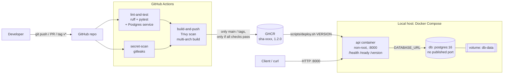

# Apex Operations API

A small HTTP API (FastAPI + PostgreSQL) packaged in Docker, deployed locally with Docker Compose, and released through a GitHub Actions pipeline that tests, scans and publishes versioned images. Built for the Junior DevOps Engineer assessment.

**What this repo demonstrates:** reproducible containers, a CI pipeline that blocks bad releases, versioned deploys with a tested rollback, structured logs and health checks, one investigated failure, and documented security choices.

| Doc | Purpose |
| --- | --- |
| [docs/RUNBOOK.md](docs/RUNBOOK.md) | Deploy, rollback, incident response, troubleshooting |
| [docs/DECISION_MEMO.md](docs/DECISION_MEMO.md) | Decisions, trade-offs, security, cost-aware cloud path, assumptions |
| [docs/AI_DISCLOSURE.md](docs/AI_DISCLOSURE.md) | How AI assistance was used |
| [docs/EVIDENCE.md](docs/EVIDENCE.md) | Every screenshot and log, what it proves, and the errors hit and fixed |

---

## Architecture



---

## Prerequisites

- Docker Desktop (tested with Docker 29.9.2, Compose v5.6.1) on macOS (Apple silicon)
- `git`, `curl`
- Optional, for running lint/tests locally: Python 3.9+

No cloud account or paid resources are needed. Images are public on GHCR.

## Quick start (run the released app)

```bash
git clone https://github.com/Zakeer3551/apex-ops-api.git
cd apex-ops-api

# 1. Create your local config from the template (never committed)
cp .env.example .env
#    Optionally change POSTGRES_PASSWORD, and the same password inside DATABASE_URL

# 2. Deploy a released version (pulls the image, starts db + api, waits for /ready)
./scripts/deploy.sh 1.2.0
```

Expected last line: `==> SUCCESS. Running: {"version":"1.2.0"}`

Then open:

| URL | What you get |
| --- | --- |
| http://localhost:8000/health | `{"status":"ok"}` (process alive) |
| http://localhost:8000/ready | `{"status":"ready"}` (database reachable) or 503 |
| http://localhost:8000/version | Version baked into the running image |
| http://localhost:8000/docs | Interactive API docs |

Stop (data is kept): `docker compose down`. Wipe data too: `docker compose down -v`.

## API

| Method | Path | Result |
| --- | --- | --- |
| GET | `/health` | 200 always while the process is up (liveness) |
| GET | `/ready` | 200 if DB answers `SELECT 1`, else 503 (readiness) |
| GET | `/version` | `{"version": "<APP_VERSION>"}` |
| POST | `/items` | 201 `{"id","name"}`; 422 if name empty, missing, or > 100 chars |
| GET | `/items` | List of items |
| GET | `/items/{id}` | 200 item, 404 if missing, 422 if id not a number (since 1.1.0) |

Example:

```bash
curl -s -X POST localhost:8000/items -H 'content-type: application/json' -d '{"name":"pump-07 check"}'
curl -s localhost:8000/items
```

---

## Local development (lint and tests)

```bash
python3 -m venv .venv
source .venv/bin/activate
pip install -r requirements-dev.txt

ruff format --check . && ruff check . && pytest -v
```

Locally the integration tests are skipped (no `DATABASE_URL`); CI runs them against a real Postgres. To build an image from local code: `docker build -t apex-ops-api:dev .`

## Tests and automated checks

| # | Check | Where | Blocks release? |
| --- | --- | --- | --- |
| 1 | `ruff check` (lint) | CI `lint-and-test` | Yes |
| 2 | `ruff format --check` | CI `lint-and-test` | Yes |
| 3 | 9 unit tests (`tests/test_api.py`) | CI + local | Yes |
| 4 | 3 integration tests against real Postgres (`tests/test_integration.py`) | CI | Yes |
| 5 | gitleaks secret scan (full git history) | CI `secret-scan` | Yes |
| 6 | Trivy image scan: report HIGH/CRITICAL, fail on CRITICAL | CI `build-and-push` | Yes (CRITICAL) |
| 7 | Docker image build (amd64 + arm64) | CI `build-and-push` | Yes |
| 8 | Readiness gate after deploy (`/ready` within 30 s) | `scripts/deploy.sh` | Reports FAILED |
| 9 | Container health checks (`pg_isready`, `/health`) | `compose.yaml` | API waits for healthy DB |

Unit tests cover: health response, readiness 503 when DB is down, **no password leaked in the error**, input validation (empty / too long / missing name, non-numeric id), version endpoint, request-ID header.

**Intentional failure:** PR `demo/intentional-failure` changes `/health` to return `"okay"`. CI fails `test_health_returns_ok` and `build-and-push` is **skipped**, so no image is published. The PR is left open, unmerged, as evidence ([E14](docs/evidence/e14-pr-intentional-failure-blocked.jpg), [E15](docs/evidence/e15-ci-intentional-failure-log.jpg)).

## CI/CD pipeline

`.github/workflows/ci.yml` runs on every push to `main`, every pull request, and every `v*` tag:

1. `lint-and-test` and `secret-scan` run in parallel.
2. `build-and-push` runs **only if both pass** (`needs:`). It builds, scans with Trivy, then builds for amd64 + arm64.
3. Images are pushed to GHCR only for `main` and tags. PRs build but never publish.
4. Tags: `sha-<commit>` for every `main` build; `1.2.0` for git tag `v1.2.0`. No `latest`.
5. Permissions: `contents: read`, `packages: write`. Push uses the per-run `GITHUB_TOKEN`; no stored credentials.

## Release and rollback

```bash
git tag v1.3.0 && git push origin v1.3.0     # release: CI publishes ghcr.io/zakeer3551/apex-ops-api:1.3.0
./scripts/deploy.sh 1.3.0                    # deploy that exact image
./scripts/rollback.sh                        # back to the version that ran before
```

`deploy.sh` pulls first (fails before changing anything if the version doesn't exist), records the running version in `.previous-version`, replaces only the `api` container (DB keeps running, data kept), and reports SUCCESS only if `/ready` passes within 30 s. Demonstrated: 1.0.0 → 1.1.0 → rollback to 1.0.0, about 6 s each, data intact ([L07](docs/evidence/logs/L07-deploy-and-rollback.txt), [E16–E18](docs/EVIDENCE.md#4-release-and-rollback)). Full procedure: [RUNBOOK](docs/RUNBOOK.md).

## Observability

- **Structured logs:** one JSON line per request to stdout, with `time`, `level`, `event`, `method`, `path`, `status`, `duration_ms`, `request_id`. Errors and readiness failures are logged with the error type only (never connection strings). Read with `docker compose logs api`.
- **Request IDs:** taken from the `x-request-id` header or generated, and returned in the response, so a user report can be matched to a log line.
- **Health checks:** `/health` (liveness) and `/ready` (readiness) endpoints; Compose health checks on both containers; the API waits for a healthy DB.
- **Metrics and alerts:** a proposal is in the [decision memo](docs/DECISION_MEMO.md#metrics-and-alert-proposal).
- **Failure investigation:** a wrong DB password was deployed and investigated from logs ([RUNBOOK, incident report](docs/RUNBOOK.md#incident-report-wrong-database-password)).

## Security summary

- No secrets in git, image or code: `.env` is gitignored and dockerignored, `.env.example` has placeholders, and the app reads `DATABASE_URL` at runtime.
- The container runs as non-root `appuser`; the DB has no published port; CI jobs get least-privilege permissions.
- Pinned dependency versions; gitleaks and Trivy in CI.
- Details, trade-offs and the production approach: [decision memo](docs/DECISION_MEMO.md#security).

## Evidence

Full list with descriptions: [docs/EVIDENCE.md](docs/EVIDENCE.md).

| Claim | Evidence |
| --- | --- |
| Image builds, runs as non-root, serves `/health` and `/docs` | [E03](docs/evidence/e03-docker-build.jpg), [E04](docs/evidence/e04-docker-run-health-docs.jpg) |
| API waits for a healthy DB | [E06](docs/evidence/e06-compose-db-init-api-start.jpg) |
| Data persists across `down` / `up` | [E07](docs/evidence/e07-items-persist-after-restart.jpg), [L02](docs/evidence/logs/L02-items-validation-and-persistence.txt) |
| Lint and tests pass locally and in CI | [E08](docs/evidence/e08-local-lint-and-tests-pass.jpg), [E13](docs/evidence/e13-ci-8-tests-with-real-postgres.jpg) |
| A failing test blocks publishing | [E14](docs/evidence/e14-pr-intentional-failure-blocked.jpg), [E15](docs/evidence/e15-ci-intentional-failure-log.jpg) |
| Deploy by version and roll back, data intact | [L07](docs/evidence/logs/L07-deploy-and-rollback.txt), [E16](docs/evidence/e16-v1.1.0-get-item-works.jpg), [E17](docs/evidence/e17-rollback-v1.0.0-route-gone.jpg), [E18](docs/evidence/e18-rollback-data-intact.jpg) |
| JSON logs and healthy containers | [L09](docs/evidence/logs/L09-deploy-1.2.0-logs-and-incident.txt) |
| Failure detected, investigated, fixed | [E19](docs/evidence/e19-incident-deploy-failed.jpg), [E20](docs/evidence/e20-incident-investigation.jpg), [E21](docs/evidence/e21-incident-fixed.jpg) |
| Problems hit and how they were fixed | [E01](docs/evidence/e01-setup-docker-command-not-found.jpg), [L03](docs/evidence/logs/L03-pip-psycopg-not-available.txt), [L05](docs/evidence/logs/L05-ci-format-check-failure.txt), [E22](docs/evidence/e22-ci-trivy-action-not-found.jpg) |

## Repository layout

```
app/main.py                  API code
tests/                       unit + integration tests
Dockerfile, .dockerignore    image (python:3.12-slim, non-root)
compose.yaml                 api + postgres + volume + health checks
.env.example                 config template (copy to .env)
scripts/deploy.sh            versioned deploy with readiness gate
scripts/rollback.sh          redeploy previous version
.github/workflows/ci.yml     CI/CD pipeline
docs/                        runbook, decision memo, evidence, AI disclosure
```
